# Interview lab: building an LRU cache

A guided exercise in hash maps, doubly linked lists, and translating diagrams into code.

**Audience:** someone comfortable with basic programming and Python objects who does not remember linked lists. The concepts and exercises are language-independent; the current implementation is Python, with Rust planned as a follow-up.

**Learning goal:** reconstruct the data structure from its rules rather than memorize an implementation.

*This python implementation was created over an all day (with interruptions) session with the Pi coding agent backed by GPT-sol-6.1 (high) and the most excellent [pi-socratic-tutor-mode-extension](https://github.com/memgrafter/pi-socratic-tutor-mode-extension) published by a friend.*

## 1. The real interview context

This exercise came from a **30-minute live whiteboarding interview** for an infrastructure, DevOps, and cloud computing role, during a cross-functional interview round.

The candidate had studied related material earlier in the year but did not have the pattern readily available. From memory, reaching the linked-list portion took approximately 20 minutes, and the implementation remained incomplete. The initial reconstruction in this directory contained a dictionary, a Python list for recency, a node sketch, and unfinished operations.

This lab records the subsequent guided practice—not the interviewer's exact prompt or scoring rubric. We do not know the interview outcome or whether every requirement below was part of the original assessment.

The central difficulty was **not deciding which item was least recent**. It was expressing that order through object references. Learning that representation and solving the timed problem at once created a large cognitive load.

An LRU exercise tests a particular programming pattern. Struggling with it alone does not establish someone's ability to operate infrastructure, debug distributed systems, or design cloud systems. Its relevance depends on the actual role.

## 2. Prerequisites and learning objectives

Before starting, be able to:

- Distinguish a class/type from an individual object/instance.
- Use a dictionary or hash map to retrieve an entry by key.
- Explain that two variables can refer to the same mutable object.
- Recognize an absent reference: `None`, `null`, or an optional value.

After completing the lab, be able to:

1. Trace LRU behavior without writing code.
2. Explain why a hash map and a doubly linked list complement each other.
3. Translate a drawn arrow into an update to one field.
4. Handle first, middle, last, and only-node cases.
5. Keep the dictionary and linked structure consistent.
6. Test structural correctness, not just returned values.
7. Explain the additional representation choices required in Rust.

## 3. Define the behavior before choosing a representation

**LRU means least recently used.** When a cache exceeds its capacity, discard the entry that has gone longest without use.

For this lab:

- A successful read counts as use.
- Updating an existing key counts as use.
- A newly inserted key is most recent.
- A missing read does not change recency.
- Updating an existing key does not increase the entry count.

Always write recency in the same direction:

> **Least recently used → most recently used**

With capacity 2:

| Operation | Returned value | Recency afterward |
|---|---|---|
| Insert A with value 10 | — | `[A]` |
| Insert B with value 20 | — | `[A, B]` |
| Read A | 10 | `[B, A]` |
| Insert C with value 30 | — | `[A, C]`; B is evicted |

**Checkpoint:** explain why a read changes the order even though it does not change a stored value.

### Contract used by the Python exercise

| Question | Current behavior |
|---|---|
| What does a missing read return? | `None` |
| What happens to an existing key on write? | Update its value and make it most recent |
| What does capacity 0 mean? | Retain no entries |
| When is capacity checked? | After inserting a new entry |
| Are negative capacities supported? | Not defined or validated |

If values may themselves be `None`, the Python return value alone cannot distinguish a miss from a hit containing `None`. The internal lookup still distinguishes them. A production API should make that ambiguity an explicit choice.

## 4. Two structures, two jobs

The target is **average O(1)** lookup, update, and eviction, with **O(capacity)** storage. Hash-map operations are average O(1), not an unconditional worst-case guarantee.

| Structure | Job |
|---|---|
| Hash map: key → node | Find an existing entry without walking the chain |
| Doubly linked list | Maintain recency and rearrange known nodes without shifting other entries |

A Python list can represent the order, but removing a middle entry shifts later elements: O(n) work. Appending afterward does not eliminate that removal cost.

A linked list changes a bounded number of references instead. However, **finding a node by walking a linked list is still O(n)**. The hash map supplies the node directly; the list alone does not meet the target.

### What is a doubly linked list?

A node stores:

- A key.
- A value.
- A reference to its previous neighbor.
- A reference to its next neighbor.

It is **doubly** linked because it supports both directions.


For this representation, A's previous reference and C's next reference are absent. No separate array or Python list is required to contain the nodes.

## 5. References: the concept that needed the most practice

A reference identifies an existing object. It is not necessarily a numeric position, a key string, or a copy of that object.

Distinguish:

| Thing | Meaning |
|---|---|
| Node type/class | A description of how nodes are constructed |
| Node instance | One actual node with its own fields |
| Reference to a node | A way to reach that instance |
| Absent reference | There is no node in this direction |

The cache holds references to the first and last nodes. Individual nodes hold references to their neighbors. Multiple references may identify **the same node**.



The dictionary does not contain a second copy of each linked node. It provides another route to the same objects.

### Reading a reference chain

Read `node.prev.next` from left to right:

1. Start at the object identified by `node`.
2. Follow its previous reference.
3. Access that object's next field.

If `node` is B, and B's previous neighbor is A, this accesses **A's next field**.

Assigning to that field changes one arrow originating at A. It does not automatically change the reverse arrow or move an object in memory.

### Why the arrows can seem circular

After A and B are connected, following A's next and then B's previous returns to A. That is expected.

But after setting only B's previous reference to A, A's next may still be absent. **Reverse links do not update themselves.**

The links are data, not instructions that run automatically. Traversal follows only the direction the program chooses. Ownership cycles are a separate concern in languages such as Rust.

## 6. Rules that must hold between operations

These are **invariants**: facts that must be true when a public operation finishes.

1. The dictionary and chain contain exactly the same live nodes.
2. Every key has exactly one live node.
3. `start` identifies the least-recent node; `end` identifies the most-recent node.
4. The first node has no previous neighbor.
5. The last node has no next neighbor.
6. Neighbor links agree: if X's next is Y, Y's previous is X.
7. Following next references reaches every live node once, then stops.
8. An empty cache has neither a start nor an end.
9. A one-node cache has start and end referring to the same node.
10. The entry count does not exceed capacity after an operation finishes.

Temporary states inside a rearrangement can differ. For example, the **old end** acquires a next neighbor before the cache's end reference is updated.

> **End is a role a node currently holds, not a permanent property of that node.**

Likewise, an insert-first implementation may temporarily have capacity + 1 entries before evicting.

## 7. Translate pictures into updates

Do not begin by memorizing a sequence of assignments. Use this process:

1. Draw the current structure.
2. Draw the desired structure.
3. Identify each changed arrow.
4. For each arrow, name its **owner field** and **target**.
5. Preserve any references you will need before overwriting them.

### Worked reasoning: promote a middle node

Read B from this chain:


For readability, the next three diagrams show only forward links. Backward links must be updated too.

**Operation 1: bypass B.** Its neighbors become neighbors of each other.



This is a logical view of the remaining chain; B may still have old field values until they are cleared or overwritten.

| Desired relationship | Owner field | New target |
|---|---|---|
| A leads to C | A's next | C |
| C points back to A | C's previous | A |

**Operation 2: append B after the old end.**



| Desired relationship | Owner field/reference | New target |
|---|---|---|
| Old end leads to B | D's next | B |
| B points back to old end | B's previous | D |
| Nothing follows B | B's next | Absent |
| B is now most recent | Cache's end | B |

**Why four nodes?** With only `A ↔ B ↔ C`, B's next neighbor is also the end. That hides the mistake of appending after the former neighbor instead of after the actual end.

**Checkpoint:** explain why D must remain reachable while B is being moved.

## 8. Boundary cases are part of the operation

| Accessed node | Required reasoning |
|---|---|
| Middle | Reconnect both neighbors, then append |
| First, with a successor | Advance start, clear the new first node's previous link, then append |
| Already last | Return the value; no rearrangement |
| Only node | Already last; the same no-rearrangement rule applies |
| Missing | Return the miss result; do not change links |

A first-node helper assumes there is a successor. Calling it for the only node attempts to modify an absent neighbor.

A useful early-return rule avoids that problem: a node already at the most-recent end needs no promotion.

### Naming the operations

A helper is useful when it expresses a recognizable operation such as **detach** or **move to most recent**. It is not necessary to create a helper for every assignment.

The current Python version has separate first-node and middle-node helpers. That is the result of the learning sequence, not a requirement for every implementation.

## 9. Existing-key writes and eviction

### Existing-key writes

An existing-key write changes the node's value and promotes that **same node**. It does not create an additional node.

Example: writing A = 99 into `[A, B]` produces `[B, A]`, with A holding 99 and still only two nodes.

The exercise reused successful-read promotion for this path. Other implementations may share a dedicated promotion operation instead.

Two mistakes encountered here:

- **Testing the returned value for existence:** a stored zero is not a missing entry.
- **Falling through into insertion:** after promoting the existing node, appending it again can create self-links.

Use node presence to decide whether the entry exists. Keep the update path separate from new-node insertion.

### Eviction

The current implementation inserts first, then evicts if the count is **greater than** capacity. Equality means full, not overfull.

Eviction starts at the least-recent end:



The victim's own key identifies which dictionary entry to remove. Its next reference identifies the new start. These are not necessarily the incoming key or incoming node.

After advancing start:

- If a node remains, it must have no previous neighbor.
- If no node remains, end must also become absent.

Capacity 0 exercises that empty-cache path. Check whether the new start exists **before accessing any of its fields**.

<br clear="all">

## 10. Session mistakes worth practicing deliberately

| Misconception or bug | Correction |
|---|---|
| Recency changes only on writes | Successful reads also count as use |
| Links must be positions in a Python list | Nodes can refer directly to other nodes |
| Assigning the node class creates a link to a node | A class is not an instance |
| First/last flags locate boundary nodes | Cache-held references locate them without a scan |
| One direction updates the opposite direction | Each arrow is maintained explicitly |
| End's next can never change | The old end acquires a successor before the role moves |
| A middle node's next neighbor is the end | Only true in some small examples |
| Returning a node is returning its cached value | The node and its payload are different things |
| Missing entries need exception handling | An optional lookup result can be checked directly |
| Boolean `and` compares both keys | Each comparison must be explicit; node identity is clearer here |
| Updating an existing key can continue into append | Finish the update path before new-entry insertion |
| The incoming key identifies the eviction victim | The least-recent node identifies its own key |
| Checking a field also checks whether its owner exists | The owner must exist before its field can be read |

These were representation and control-flow mistakes, not a failure to understand which entry should be least recent.

## 11. Test behavior and structure

Files:

- [`lru-cache.py`](lru-cache.py): learner's implementation.
- [`test_lru_cache.py`](test_lru_cache.py): standard-library unit tests.

Run:

```sh
python -m unittest -v test_lru_cache.py
```

At the end of the session, **all 8 tests passed**. They cover:

1. Missing reads without recency changes.
2. Promoting first, middle, and last nodes in a four-node chain.
3. Promoting the first of two nodes.
4. Updating existing first, middle, and last nodes without replacing their identity.
5. Eviction after reads and existing-key writes.
6. Falsy keys and values, including zero and an empty string, plus stored `None`.
7. Capacity 1: repeated reads, updates, and replacement.
8. Capacity 0: repeated inserts retain nothing.

The order assertion also checks dictionary membership, node identity, backward links, the end reference, and termination of the forward chain. Its walk is bounded, so a cycle fails rather than hangs the test.

**Why inspect the structure?** A read can return the correct value while leaving an unreachable node or a cycle that breaks a later operation.

This is a targeted regression suite, not proof of correctness. Negative capacities, exhaustive operation sequences, and randomized comparison against a reference model remain outside the suite.

## 12. Curriculum: repeat the skills, then add the clock

These are suggested checkpoints, not another interview timer.

| Stage | Exercise | Ready to advance when… |
|---|---|---|
| 1. Behavior | Trace reads, writes, updates, and eviction using key sequences only | Recency order is consistently correct |
| 2. References | Draw two nodes and follow next/previous references | You distinguish objects from references and positions |
| 3. List operations | Draw first-, middle-, and last-node moves using four nodes | Every changed arrow has an owner and target |
| 4. Implementation | Implement untimed from the contract and invariants | You can explain each update without copying |
| 5. Verification | Run boundary and structural tests | Failures can be explained using a diagram |
| 6. Transfer | Reimplement in another language | Behavior stays the same despite representation changes |
| 7. Timed reconstruction | Build from a blank file or whiteboard | The pattern is familiar enough to explain while coding |

Use spaced repetition: rebuild later, inspect mistakes, and revisit on another day. Repeatedly copying the finished code does not exercise reconstruction.

### A possible 30-minute rehearsal

Once the untimed version is familiar:

- **0–4 minutes:** clarify API, missing reads, capacity, and whether helpers or library collections are allowed.
- **4–8:** explain the two structures, draw the invariants, and choose a boundary representation.
- **8–23:** implement small operations and compose the public API.
- **23–30:** trace a four-node move, duplicate update, eviction, and one-node case; state complexity and remaining assumptions.

This is a rehearsal plan, not a promise that every interviewer expects the same solution or pace. Dummy boundary nodes can reduce special cases, but they are an optional later exercise, not a prerequisite for understanding this version.

## 13. Tomorrow's Rust follow-up

**Keep the behavior and tests conceptually unchanged. Reconsider the representation explicitly.** Translating Python references directly into ordinary Rust references inside an owning cache is not a mechanical port.

Python hides much of the ownership and lifetime management. Rust asks who owns each node and how mutation is permitted when several links identify it.

Before coding, answer:

1. What owns node storage?
2. What does each link store?
3. Can two links identify the same node without creating conflicting mutable borrows?
4. Can deletion leave stale references or handles?
5. How are absent links represented?
6. How does the API distinguish a missing value from a stored value?
7. Which operations remain average O(1)?

### Two representation options to investigate

| Option | Benefit | Additional concepts |
|---|---|---|
| Owned arena/slot storage with stable integer handles | Links do not need to borrow other nodes directly | Slot reuse, invalid handles, bounded storage, and safe mutation of separate slots |
| Shared node ownership with interior mutability | Resembles an object-reference diagram | Reference counting, runtime borrow checks, and weak references to avoid ownership cycles |

**Important distinction:** stable slot handles are valid linked-list links. They are not the same as positions in a sequence that shifts when an element is removed. Integers were not inherently wrong earlier; treating changing list positions as stable links was the issue.

A growing arena without slot reuse can violate the cache's O(capacity) storage goal. Strong ownership links in both directions can retain nodes through cycles. Whichever representation you choose, account for removal—not just insertion.

Suggested Rust sequence:

1. State the contract, including the accepted capacity range.
2. Choose one representation and explain its ownership model.
3. Build and inspect two connected nodes before building the whole cache.
4. Practice detach and append with four nodes.
5. Port the behavior cases and structural checks.
6. Add the hash-map lookup, update, and eviction paths.
7. Explain runtime and storage costs, including ownership/storage overhead.

Do not add unsafe code merely to make the Python layout translate literally. Choosing a representation that works with the language is part of the exercise.

## 14. Reusing this format for future interview labs

For each real interview exercise, record:

- **Context:** role, round, time limit, and requirements remembered with confidence.
- **Starting point:** what was implemented and what remained incomplete.
- **Conceptual bottleneck:** behavior, representation, language mechanics, or time management.
- **Minimal contract:** inputs, outputs, edge cases, and complexity target.
- **Visual model:** objects, links, ownership, and state transitions.
- **Guided checkpoints:** one concept or operation at a time, without an initial finished solution.
- **Evidence:** executable tests and explicit limits of verification.
- **Transfer task:** another language or representation with the same observable behavior.
- **Retrospective:** what became easier and what still needs deliberate practice.

The goal is not to memorize one cache implementation. It is to build a repeatable path from **behavior → diagrams → invariants → code → tests**.
